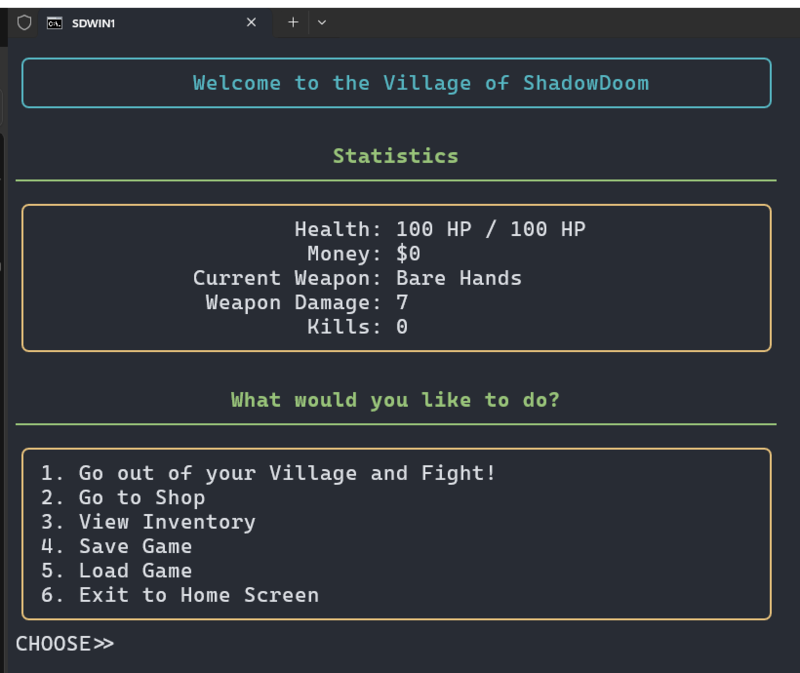
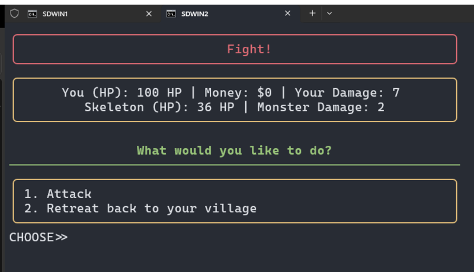

# ShadowDoom

ShadowDoom is a terminal-based fantasy game written in Python. It combines a styled text interface with sound effects, randomized encounters, combat, treasure, and lightweight progression.

<p align="center">
  
</p>

Leave the village to fight randomly generated monsters, loot treasure, and spend your money in the shop on better weapons.

<p align="center">
  
</p>

## Requirements

- Python 3.6 or newer
- Pygame
- Rich
- Tkinter

Tkinter is bundled with many Python installations, but some Linux distributions package it separately.

## Run locally

```sh
git clone https://github.com/Sid110307/ShadowDoom.git
cd ShadowDoom
python -m pip install pygame rich
python ShadowDoom.py
```

Pass `--mute` to start with audio off. During the game, enter `m` at any prompt to toggle mute.

For the intended layout, run the game in a maximized terminal window. Audio output must be available for the bundled effects and music.

## Project structure

- `ShadowDoom.py` — game loop, encounters, combat, inventory, and menus
- `utils/tui.py` — terminal rendering helpers
- `utils/audio.py` — audio playback
- `audio/` — bundled sound effects and menu audio
